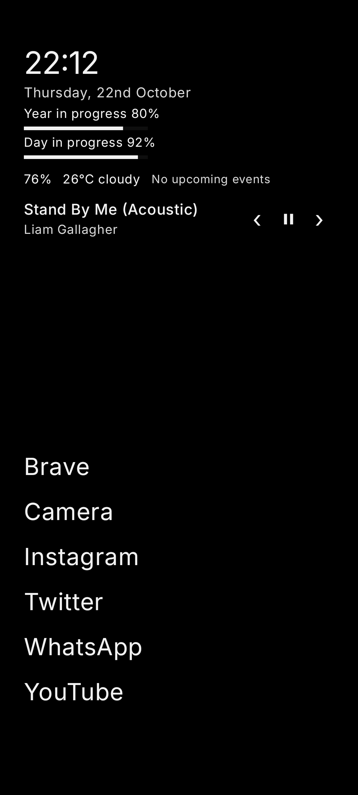
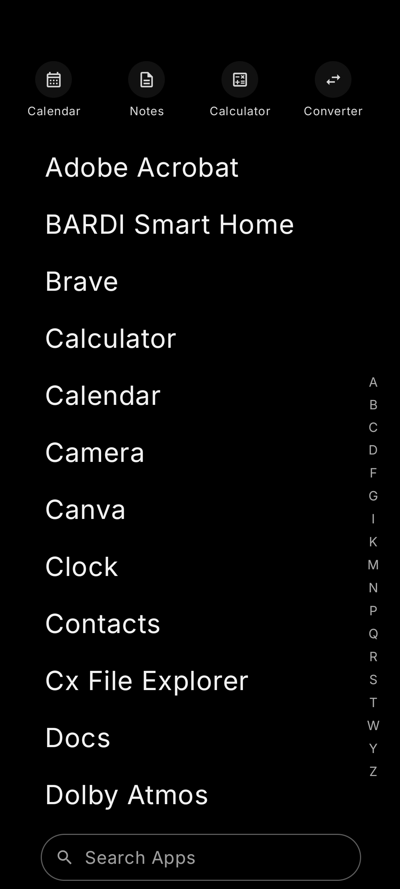
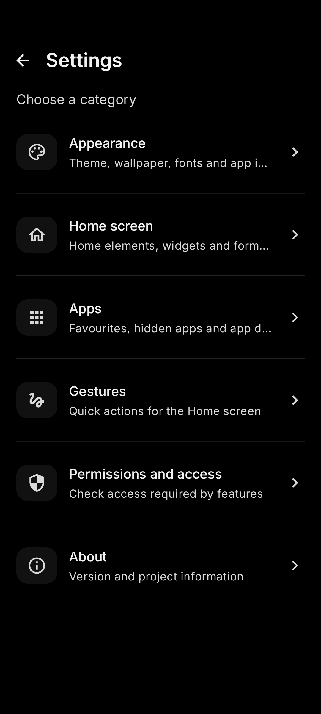
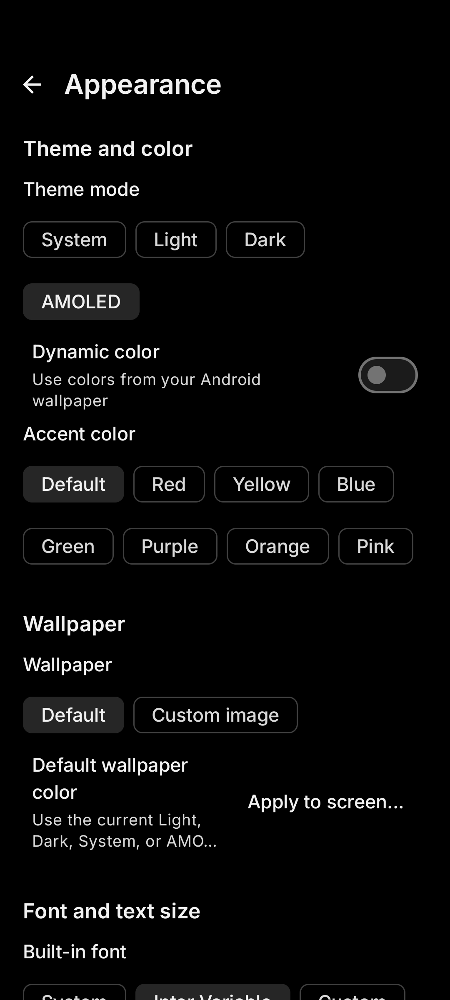
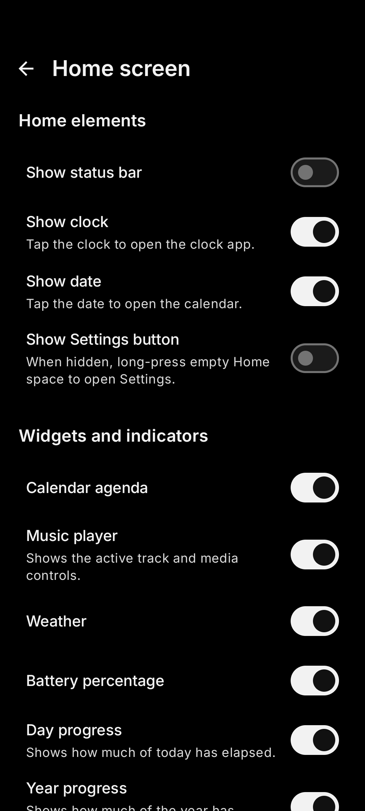
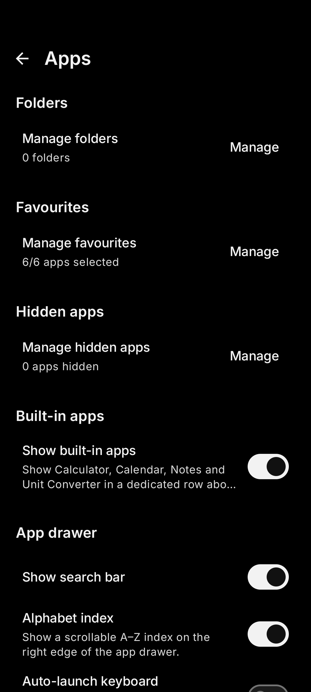
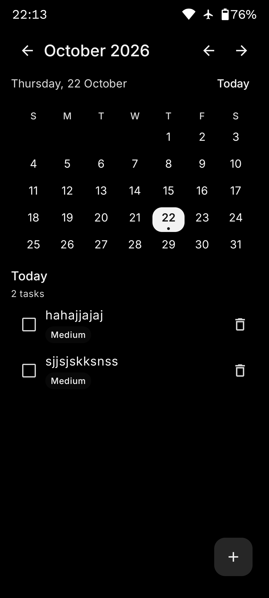
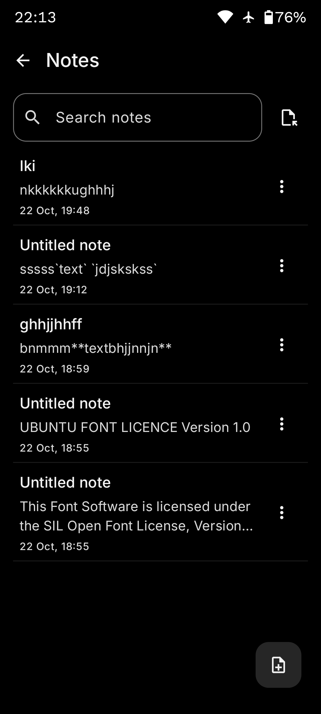

# Dislauncher

Dislauncher is a lightweight, text-first Android launcher designed to keep your Home screen calm and your apps close at hand. It combines a minimal interface with useful everyday tools, without making icons and visual effects the focus.

## Screenshots

<p align="center">
  
  
</p>

<p align="center">
  
  
</p>

<p align="center">
  
  
</p>

<p align="center">
  
  
</p>


## Key features

- **Minimal Home screen:** clock, date, progress indicators, and favourite apps in a text-first layout.
- **App drawer:** searchable alphabetical app list, favourites, folders, hidden apps, and compatible icon packs.
- **Personalisation:** System, Light, Dark, and Black themes, Dynamic Color, accent colours, wallpapers, fonts, and text sizing.
- **Everyday tools:** built-in calendar and local reminders, Markdown notes, calculator, unit converter, optional weather, and music controls.
- **Useful shortcuts:** notification dots, app actions, and optional gestures for quick access to common tasks.
- **Privacy-minded:** no account system, advertising SDK, or analytics SDK in the reviewed source. Optional features may request permissions or connect to external services.

## Download

Get the latest APK from [GitHub Releases](https://github.com/insomdroid/Dislauncher/releases/latest).

1. Open the latest release and download the APK from **Assets**.
2. Open the downloaded file and follow Android's installation prompts.
3. Select Dislauncher as your default Home app.

Download only from the official release page. See [APK safety and updates](APK_SAFETY.md) for more information.

## Tech stack

- Kotlin
- Jetpack Compose and Material 3
- Android SDK 36
- Minimum Android version: Android 8.0 (API 26)

To build a local debug APK:

```sh
./gradlew assembleDebug
```

See [BUILDING.md](BUILDING.md) for build requirements and release details.

## Privacy and permissions

Core launcher features can be used without enabling every optional permission. Weather is optional and sends approximate coordinates to Open-Meteo when enabled. Other optional access supports features such as calendar, reminders, notification dots, music controls, and double-tap-to-lock.

- [Privacy and permissions](PRIVACY.md)
- [APK safety and updates](APK_SAFETY.md)

## Links

- [Project website](https://insomdroid.github.io/Dislauncher/)
- [Source code](https://github.com/insomdroid/Dislauncher)
- [Report a bug or request a feature](https://github.com/insomdroid/Dislauncher/issues)
- [Support the project](https://ko-fi.com/insomdroid)

## License

Dislauncher is licensed under the [MIT License](LICENSE). Third-party assets and dependencies may have their own licenses; the bundled Inter font is covered by the SIL Open Font License 1.1, included at `app/src/main/assets/licenses/INTER_OFL.txt`.
