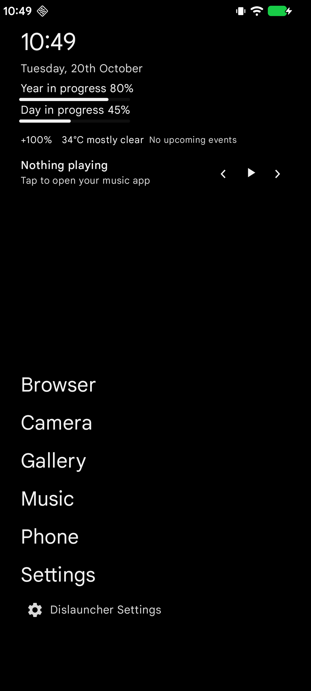
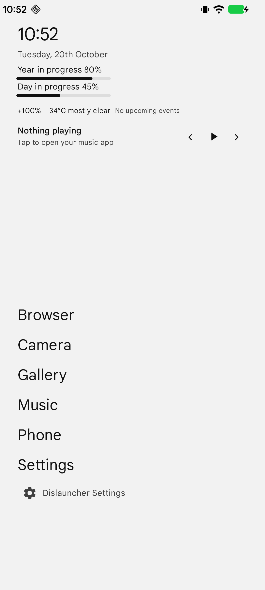
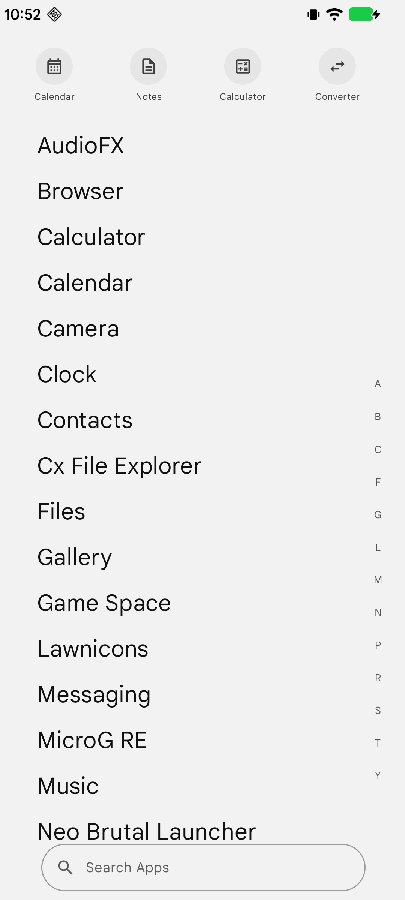
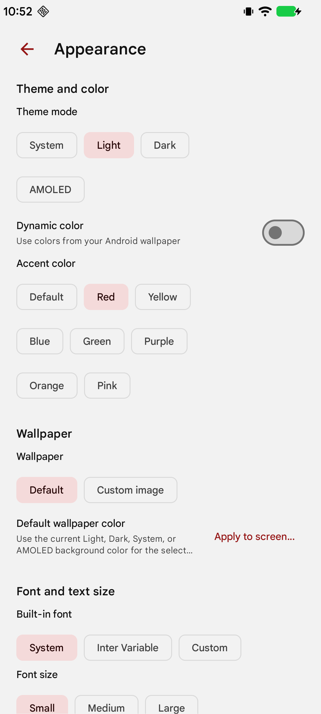
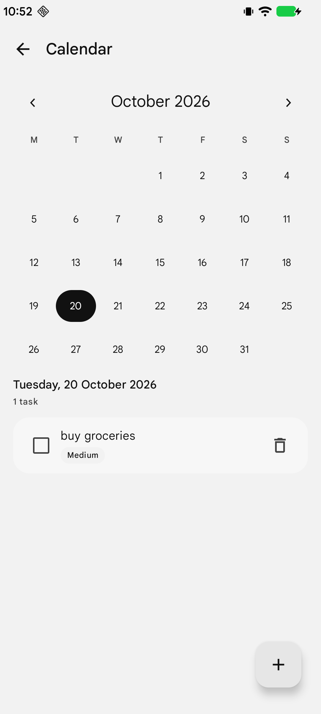
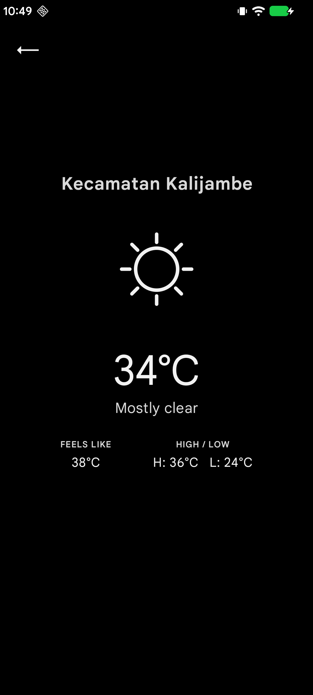

  

<h1 align="center">Dislauncher</h1>

<strong>A calmer Android Home screen, built around text instead of clutter.</strong>

A lightweight, text-first launcher for people who want their apps close at hand without turning the Home screen into another feed.

  <a href="https://github.com/insomdroid/dislauncher/releases/latest"><strong>Download the latest APK</strong></a>
  · <a href="https://github.com/insomdroid/dislauncher/issues">Report a bug</a>
  · <a href="https://ko-fi.com/insomdroid">Buy me a coffee ☕</a>

  
  
  
  

Dislauncher started as a personal project: a way to make my own phone feel simpler and more intentional. I build it with help from AI as a learning exercise and for everyday personal use. I'm sharing the source and APK publicly in case someone else finds the idea useful. It is an independent project, not a commercial product or an official Android app.

## A quick look

  
  &nbsp;&nbsp;
  
  &nbsp;&nbsp;
  

<em>Keep the Home screen quiet. Find what you need when you need it.</em>

  
<strong>More screenshots — appearance, calendar and weather</strong>

  

    
    &nbsp;&nbsp;
    
    &nbsp;&nbsp;
    
  

## What you can do with Dislauncher

### A Home screen that stays out of the way
- A clean, text-first layout with clock, date, day/year progress and favourite apps.
- Choose which Home elements appear and reorder supported items.
- Optional weather, battery percentage, calendar agenda, music controls and notification dots.
- Double-tap to lock the screen (optional Device Administrator access) and swipe down to open the notification shade.
- Keep the launcher's own background independent from the wallpaper you apply to Android.

### An app drawer built for finding things
- Search installed launcher apps and browse alphabetically with an optional A–Z index.
- Manage favourites and hide apps you do not want in the drawer.
- Choose whether to show app icons, pick a built-in icon shape, or use a compatible third-party icon pack.
- Quick access to built-in tools such as Calendar, Notes, Calculator and Unit Converter.

### Personalise the look without losing the simplicity
- **System, Light, Dark and AMOLED** appearance modes.
- Optional Android Dynamic Color plus manual accent-colour presets.
- Use a solid-colour wallpaper or choose a custom image.
- Apply a wallpaper to Android's Home screen, Lock screen, or both from one clear dialog.
- Adjust app-drawer wallpaper transparency and contrast.
- Choose System, bundled Inter Variable, or a custom TTF/OTF font (up to 5 MB), and adjust text size.

### Small tools for everyday use
- **Calendar and agenda** for viewing events, with local reminders.
- **Notes** for quick personal notes.
- **Calculator** and **Unit Converter** for quick calculations.
- **Weather** with current conditions and daily high/low when you enable location access.
- **Music controls** for supported active media sessions from the Home screen.

Features that depend on Android access remain optional. You can use Dislauncher as a basic launcher without granting location, calendar, notification-listener or device-admin access.

## Install Dislauncher from GitHub

The latest stable APK is published on the [GitHub Releases page](https://github.com/insomdroid/dislauncher/releases/latest).

1. Open the [latest release](https://github.com/insomdroid/dislauncher/releases/latest) on your Android phone.
2. Under **Assets**, download the file named **Dislauncher-vX.Y.Z.apk** (use the exact version shown on the release page). Do not download a workflow artifact or an APK re-uploaded by someone else.
3. Open the downloaded APK. Android may ask you to allow your browser or file manager to **Install unknown apps**. If you choose to continue, allow that source for this installation.
4. Review the installer and tap **Install**.
5. Open Dislauncher and follow setup. To use it as your launcher, select **Dislauncher** in Android's default Home app setting.

The wording and location of Android settings vary by manufacturer. Common paths include **Settings → Apps → Special app access → Install unknown apps** and **Settings → Apps → Default apps → Home app**. You can turn off the browser/file-manager install permission again after installing.

### A note about APK safety

Dislauncher is distributed directly from GitHub, **not through Google Play**. The APK has not gone through Google Play's app review and distribution process. Installing any APK from outside the Play Store carries risk: a modified or impersonated file could contain harmful code, and Android may show an unknown-source or Play Protect warning.

To reduce that risk:
- Download only from the official [Dislauncher Releases page](https://github.com/insomdroid/dislauncher/releases/latest).
- Review the release notes and source code, and compare the APK's SHA-256 checksum with the matching **.sha256** release asset when one is provided. New releases made by the updated workflow are intended to include this checksum; older releases may not.
- Do **not** disable Play Protect globally just to install an APK. If Android warns that the file is unsafe or blocks it, stop and investigate rather than bypassing the warning automatically.
- Do not install APKs from unofficial mirrors or unknown people.
- An APK signed with a different key cannot normally update the installed app. Avoid uninstalling an existing copy if you need to preserve its local data.

A public source repository improves transparency, but it is not a guarantee that every build is bug-free or that every downloaded file is authentic. Use the app at your own discretion.

## Android permissions and special access

Dislauncher asks for access only for features that need it. Android may display runtime permission prompts or separate special-access screens. You can decline optional access and still use the core launcher.

| Permission or access | Why it is used | Optional? |
|---|---|---|
| Approximate location | Gets an approximate location for Weather. When weather is used, coordinates are sent over HTTPS to Open-Meteo to retrieve forecast data. | Yes |
| Calendar read access | Reads calendar events for the Home agenda and Calendar screen. Dislauncher does not request permission to write to your calendar. | Yes |
| Notifications | Allows Android 13+ to show local reminder notifications. | Yes |
| Notification access (special access) | Enables selected notification dots and reads active media-session information for the music widget. Android's notification-access screen describes the broad access this grants. | Yes |
| Device Administrator (special access) | Enables optional double-tap-to-lock. The app declares the force-lock policy only; it does not request device wipe. | Yes |
| Wallpaper | Applies the selected image or colour to Android's Home and/or Lock screen wallpaper. | Yes |
| Expand status bar | Lets the swipe-down gesture open the notification shade. | Yes |
| Receive boot completed | Restores scheduled local reminders after the device restarts. | Used by reminders |
| Request package deletion | Lets Android show its system confirmation when you request an app uninstall from a supported app-management action. Android controls the final confirmation. | Only for that action |
| Internet | Fetches weather data when Weather is used. The app does not include an account sign-in or an app-operated server. | Weather needs it |

The system file picker is used for custom wallpaper and font selection, so Dislauncher does not request broad storage access. Android may show different prompts or setting names depending on the OS version and device manufacturer.

For more detail about local storage and network behaviour, see [PRIVACY.md](PRIVACY.md).

## Build from source

Dislauncher uses Kotlin, Jetpack Compose, Material 3 and the Android SDK. It targets Android SDK 36 and supports Android 8.0 (API 26) and later.

### Requirements
- JDK 17
- Android SDK Platform 36 and Build Tools 36.0.0
- A network connection on the first build so Gradle can download its pinned distribution and dependencies

### Build a debug APK

~~~sh
git clone https://github.com/insomdroid/dislauncher.git
cd dislauncher
./gradlew assembleDebug
~~~

On Windows, run **gradlew.bat assembleDebug**.

The debug APK is created at **app/build/outputs/apk/debug/app-debug.apk**. For a release-style local build, run **./gradlew assembleRelease**; unless production signing credentials are configured in the environment, it uses the debug signing key and is **not** the official release APK.

### CI and releases
- Changes to app code, Gradle files, the launcher-icon source image or build workflows trigger the build workflow.
- Screenshot-only and documentation-only changes do not trigger an APK build.
- CI runs Android lint and assembles a test APK. Test APKs are temporary CI artifacts, not official releases.
- Official release APKs are built from version tags and signed with the production signing key configured as GitHub Actions secrets. The release workflow verifies the APK signature and publishes a SHA-256 checksum.

## Typography and third-party assets

Dislauncher bundles **Inter Variable** as its display font so it works offline. Inter is designed by the Inter Project Authors and is distributed under the **SIL Open Font License 1.1 (OFL-1.1)**. The full font license is included at **app/src/main/assets/licenses/INTER_OFL.txt**. See [Inter on GitHub](https://github.com/rsms/inter) and [Google Fonts](https://fonts.google.com/specimen/Inter).

## A personal note

I made Dislauncher with AI assistance as a way to learn, experiment and build something useful for my own phone. I'm still learning, so bugs and rough edges are possible. If you find it useful, feedback through [GitHub Issues](https://github.com/insomdroid/dislauncher/issues) is welcome.

If this project makes your day a little easier and you'd like to support its continued development, you can [buy me a coffee on Ko-fi](https://ko-fi.com/insomdroid). There is no obligation — using, testing or sharing feedback is already appreciated.

## License

Dislauncher is licensed under the [MIT License](LICENSE). You may use, modify and redistribute the project, including commercially, provided the copyright and license notice are retained. This license applies to the project code; third-party assets and dependencies remain subject to their own licenses. The bundled Inter font is under the SIL Open Font License 1.1; see `app/src/main/assets/licenses/INTER_OFL.txt`.

---

**Source:** [github.com/insomdroid/dislauncher](https://github.com/insomdroid/dislauncher) · **Issues and feedback:** [GitHub Issues](https://github.com/insomdroid/dislauncher/issues)
