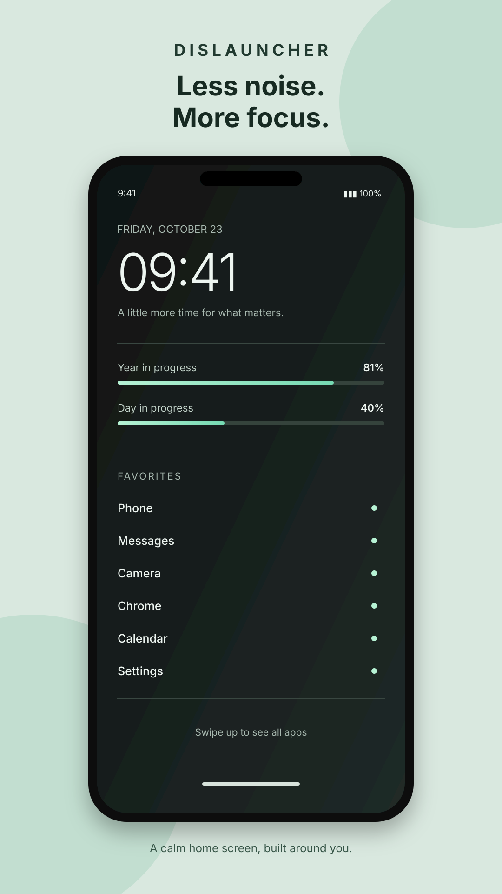
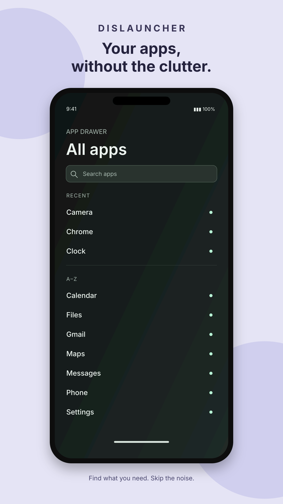
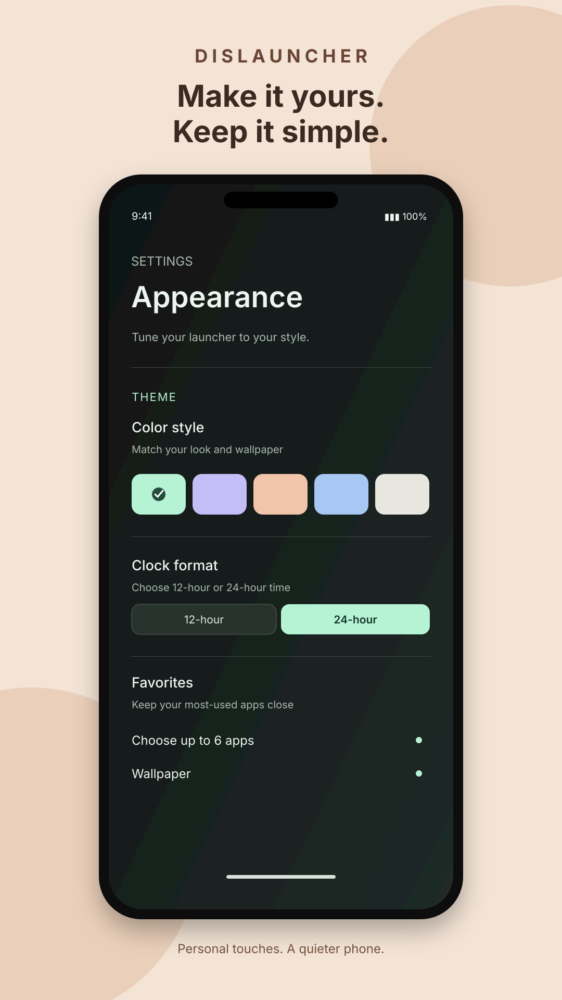

# Play Store screenshot mockups

Draft visual concepts for reviewing the Play Store presentation. These are SVG mockups and use illustrative launcher content; review the screen details against the current app before using them as official store screenshots.

## 1. Home screen

[Open full-size home mockup](PlayStore_01_Home_Mockup.svg)

## 2. Text-first app drawer

[Open full-size app drawer mockup](PlayStore_02_TextFirst_Mockup.svg)

## 3. Personalization

[Open full-size personalization mockup](PlayStore_03_Personalize_Mockup.svg)

> Note: Google Play listing screenshots should be exported to an accepted raster format (PNG or JPEG). These SVGs are editable visual drafts for feedback, not final upload-ready assets.
